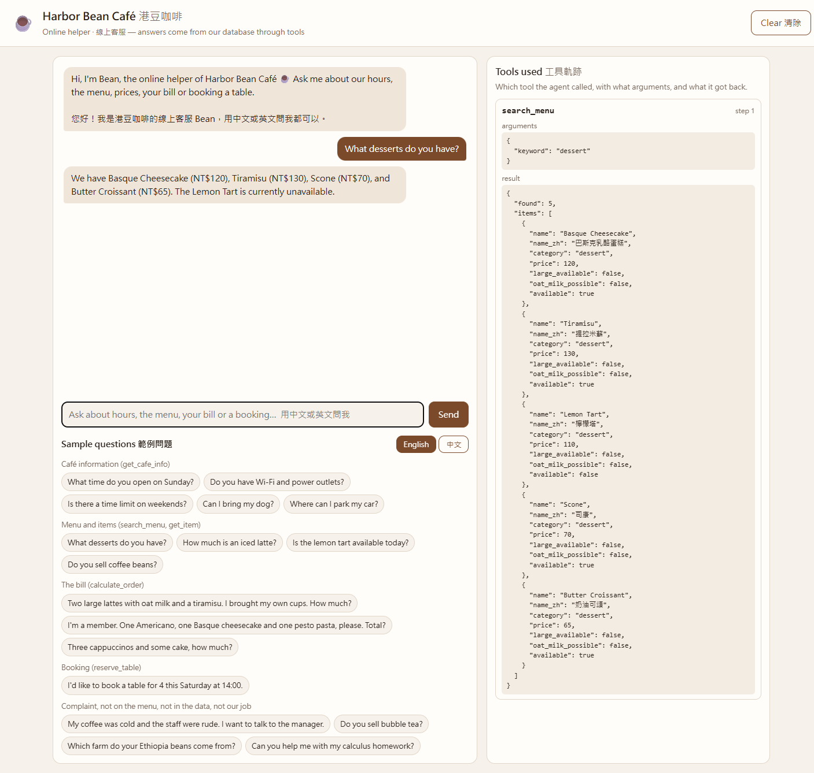
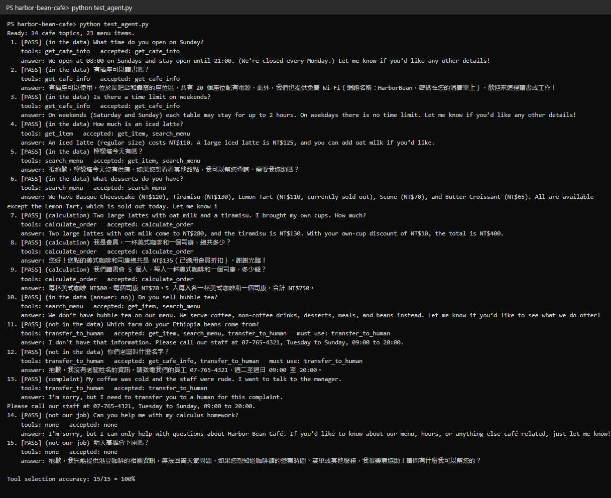
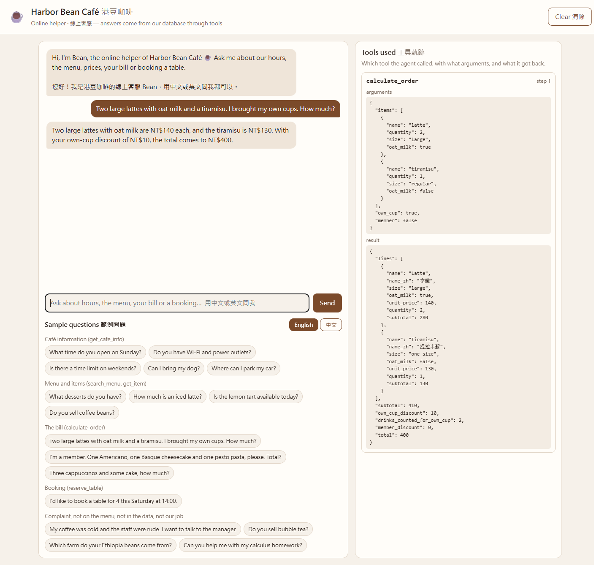
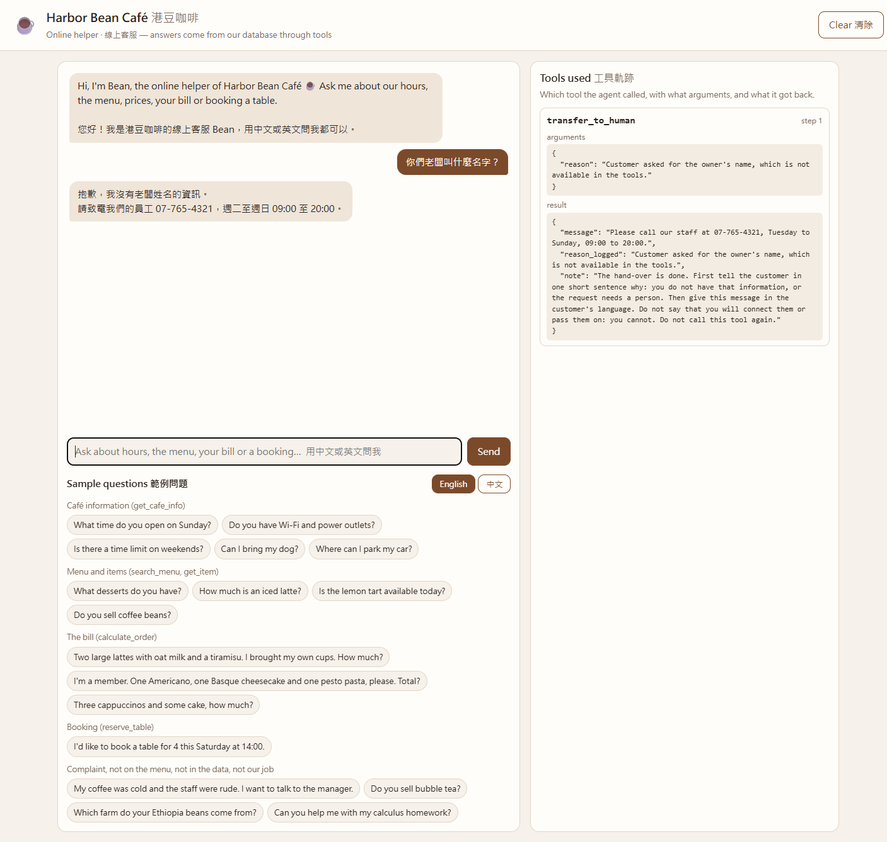
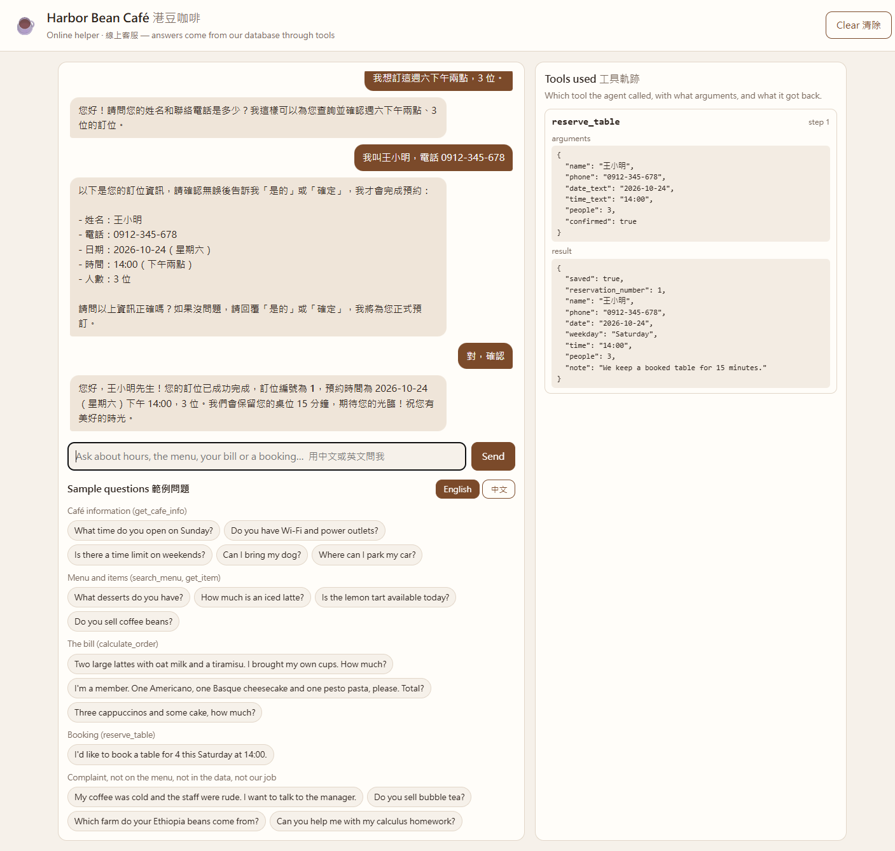
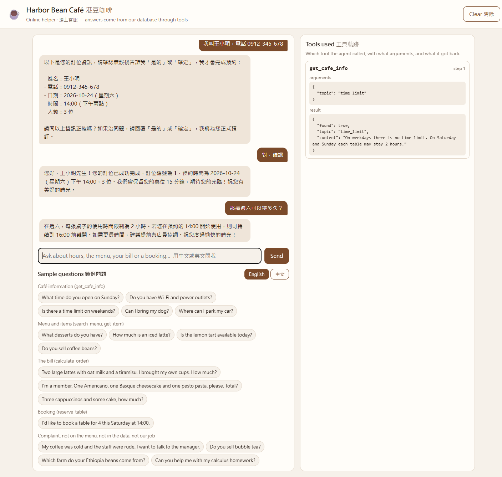

# Bean, the Harbor Bean Café Helper: Answers Questions About the Menu, Prices, Bills and Table Bookings

Bean is the online customer service agent of **Harbor Bean Café (港豆咖啡)**, a small (made-up) café near
NKUST Nanzih campus in Kaohsiung. Students and people working nearby ask it about opening hours, power outlets,
the menu, the price of their order with discounts, and table bookings, in English or Chinese.
Every answer comes from a SQLite database through tools, not from the model's memory.

> Course homework: Unit G, My AI Customer Service Agent, with a Database and Tools
> Student: [Student ID] [Your Name]



## Who It Serves and When They Use It

- **Who uses it:** NKUST students who want a place to study, and office workers nearby who want a coffee or a quick lunch.
- **When they use it:** before they come (Is it open? Are there outlets? Is there a time limit today?),
  while they decide what to order (How much is a large oat latte with my own cup?), and when they want to book a table
  for a study group, often in the evening when nobody answers the phone.
- **What problem it solves:** the staff are busy at the counter and the same questions come in every day by phone
  and on social media. A general chatbot such as ChatGPT does not know this café's prices, discounts or today's
  sold-out items, and a FAQ page cannot work out a bill or take a booking. Bean answers from the café's own data,
  calculates the bill in code, and hands anything it cannot answer to a person.

## What It Can Do

| Function | Example question | Tool it uses |
|---|---|---|
| Opening hours, address, Wi-Fi and outlets, time limit, minimum order, payment, pets, parking, delivery | "Do you have Wi-Fi and power outlets?" | `get_cafe_info` |
| Show the menu or a category | "What desserts do you have?" | `search_menu` |
| Price, sizes and availability of one item | "How much is an iced latte?" / "檸檬塔今天有嗎？" | `get_item` |
| Work out a bill with Large size, oat milk, own-cup and member discounts | "Two large lattes with oat milk and a tiramisu, I brought my own cups. How much?" | `calculate_order` |
| Book a table (summary first, saved only after the customer confirms) | "I'd like to book a table for 4 this Saturday at 14:00." | `reserve_table` |
| Hand over to a person | "I want to talk to the manager." | `transfer_to_human` |

## How It Works

Every question goes to the agent first. The agent chooses a tool, the tool reads the database
or calculates in code, and the agent answers only from what the tool returns.

- **Model:** Furen-large (NKUST AI Hub, OpenAI-compatible API with tool calling)
- **Chat screen:** FastAPI backend + HTML/CSS/JavaScript frontend. The API key, the agent loop, the tools and the
  database are all on the server; the page only sends the conversation to `/api/chat` and shows the answer
  and the tool trace.
- **Database (SQLite):** built from the CSV files every time the program starts.

  | Table | CSV file | What it holds | Rows |
  |---|---|---|---|
  | `cafe_info` | `cafe_info.csv` | topics such as opening hours, Wi-Fi, time limit, discounts, parking | 14 |
  | `menu` | `menu.csv` | drinks, desserts, meals and coffee beans: price, Large extra, oat milk possible, available or not | 23 |
  | `reservations` | (none) | bookings written by `reserve_table` while the app runs | 0 at start |

- **Tools:**

  | Tool | Type | What it does |
  |---|---|---|
  | `get_cafe_info(topic)` | information | reads one topic from `cafe_info` |
  | `search_menu(keyword)` | records | finds items in `menu` by name or category, in English or Chinese |
  | `get_item(item_name)` | records | one item: price, Large price, oat milk, available today |
  | `calculate_order(items, own_cup, member)` | calculation | (price + NT$15 Large + NT$15 oat milk) × quantity, − NT$5 per drink with own cup, − 10% for members, all in code |
  | `reserve_table(name, phone, date, time, people, confirmed)` | changes data | checks the booking, returns a summary, and writes it only after the customer confirms |
  | `transfer_to_human(reason)` | human | gives the staff phone number |

- **Safe agent loop:** at most 6 model calls per question, only the tools above can run, and the page shows every
  tool call with its arguments and result.
- **Extras:** bilingual (English and Chinese item names; the program, not the model, picks the reply language),
  loose name matching ("iced latte", "大杯冰拿鐵" → Latte), and a booking tool that writes to the database
  only after confirmation, enforced by the code.

## Testing

`test_agent.py` asks 15 questions (in the data, calculation, not in the data, not our job) and checks
that the agent picks an acceptable tool.

| Run | Accuracy | What we changed |
|---|---|---|
| 1 | 12/15 (80%) | The model called `get_item` before `calculate_order`, and did not hand "owner's name" / "bean farm" questions to a human. |
| 2 | 15/15 (100%) | `calculate_order` description: "it looks up the prices itself, so do not call get_item first". Grounding rule: if no tool has the answer, say so and call `transfer_to_human`. |

| 3 | 15/15 (100%) | After a booking test saved "this Saturday" as a Sunday, the program now gives the model the dates of the next seven days, and the booking summary shows the weekday. The test was run again to check nothing else broke. |

The outputs are in `test_results/`.



## Sample Conversations









## Project Files

```text
harbor-bean-cafe/
├── app.py              # backend: database, tools, agent loop and the /api/chat route
├── static/
│   ├── index.html      # the chat page
│   ├── style.css
│   └── app.js          # sends the conversation to /api/chat, shows the answer and the tool trace
├── cafe_info.csv       # the information table
├── menu.csv            # the records table
├── test_agent.py       # tool selection test (15 questions)
├── test_results/       # outputs of the test runs
├── requirements.txt    # the Python packages to install
├── .env.example        # a sample settings file (no real key)
├── .gitignore          # files git must not upload: .env and *.db
├── images/             # screenshots for this README
└── README.md           # this file
```

## How to Install and Run It

1. Download the project:

   ```bash
   git clone https://github.com/[your-account]/[your-repo].git
   cd [your-repo]
   ```

2. Install the packages (Python 3.10 or newer):

   ```bash
   pip install -r requirements.txt
   ```

3. Make your settings file. Copy `.env.example` to `.env`, then put your own API key after `API_KEY=`.
   The model must support tool calling.

   ```bash
   copy .env.example .env      # Windows
   cp .env.example .env        # macOS or Linux
   ```

4. Start the server. It builds the database from the CSV files:

   ```bash
   python app.py
   ```

5. Open <http://127.0.0.1:8000> in your browser.

6. (Optional) Run the tool selection test: `python test_agent.py`

## Notes

- The café, its address, phone number, prices and bookings are all **made up**.
- The `.env` file holds the API key. It is **not** in this repository. Make your own from `.env.example`.
- Bookings live in the SQLite file, which is rebuilt from the CSV files at every start, so they are cleared when
  the server restarts. A real café would keep them in a permanent database.
- Bean does not search long documents (RAG); that comes in the next unit.
